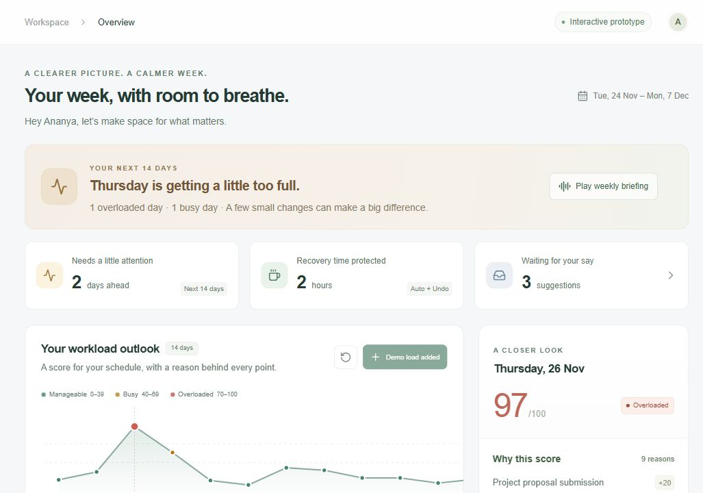
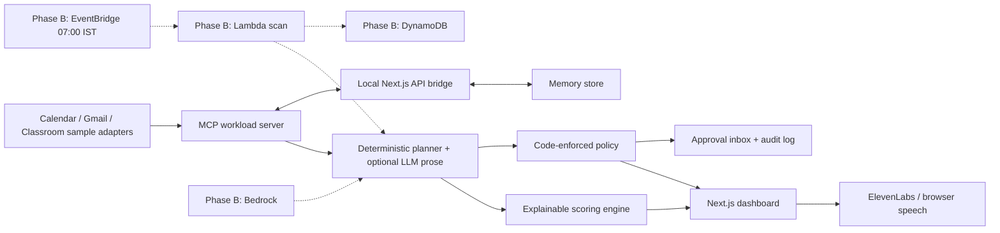

# Overload Guard

**Other tools fit more work into your week. Overload Guard tells you when it’s too much — and helps you say no.**

A working Phase A prototype for wHACKiest 2026, Track 1: **Make MCP Matter**. Built for Ananya, a second-year engineering student balancing classes, evaluations, lab records, projects and club work.

## Run locally

Requires Node.js **22.12+** (Node 24 recommended) and npm. No API keys, database, Docker, accounts or OAuth setup are needed.

```sh
git clone https://github.com/Karan-Koder/Overload_Guard.git
cd Overload_Guard
npm install
npm run dev
```

Open **http://127.0.0.1:3000**. Once dependencies are installed, the complete default experience runs offline. Browser speech depends on an installed operating-system voice. If voice is unavailable, the transcript remains readable.

The app binds to loopback. It is a single-user demonstration with a process-wide memory store, **not a public multi-user deployment**. State survives navigation and hot reload, but resets on server restart. Do not enter real student data or credentials. If port 3000 is occupied, free that port before using the MCP bridge.

```sh
npm test          # Deterministic engine, policy, injection, lifecycle, HTTP boundary, MCP contracts
npm run typecheck
npm run build    # Production build, using Webpack for Windows reliability
npm start        # Serve the built app
npm run test:api # Live HTTP lifecycle checks; start the app first; restores clean seed data
npm run test:mcp # Real MCP client/server stdio smoke test using an isolated memory store
```

## The problem

A calendar shows when you are busy. It rarely connects exam prep, a lab-record deadline, late-night project work and a club meeting into an early warning. Overload Guard combines those signals, explains every score, and proposes changes that leave the student in control.

## Two-minute demo

1. Open **Overview**. The coming Thursday is **57 / Busy**, generated relative to today in Asia/Kolkata.
2. Click **Add demo load**. A Classroom assignment, Gmail project deadline and two-hour meeting raise Thursday to **97 / Overloaded**, with nine reasons.
3. Inspect the lighter-week plan: two recovery hours are protected in the local demo calendar, with **Undo**. Two extension drafts and a club-meeting proposal await approval.
4. The calculated preview is **97 → 57** if both extensions are granted and the move is accepted. Approval itself does **not** change deadlines or imply the professor agreed.
5. Open **Approval inbox**, edit the Linear Algebra draft, save, and approve. In **Activity log**, see **“Draft approved — saved as Gmail draft (prototype)”**. This means a local simulated draft; no connection to real Gmail and no email sent.
6. Open **Inspect the flagged email** on Overview. Its assistant-directed instruction is highlighted and ignored. The actual registration deadline still counts.
7. Click **Play weekly briefing**. ElevenLabs is optional; the default uses browser speech synthesis with a readable transcript.
8. Try **Settings** source toggles, language selection, and data deletion. **Reset demo** restores the original scenario. Undo does not automatically recreate a recovery block during the next scan.

### Screenshots

Captured from the running prototype. See `docs/DEMO.md` for the presentation script and `docs/VERIFICATION.md` for the checks performed.



[Full dashboard](docs/screenshots/dashboard.jpg) · [Mobile layout](docs/screenshots/mobile.jpg)

## Features

- Fourteen-day workload timeline, selectable days, source-tagged commitments and point-by-point explanations.
- Pure TypeScript scoring: deadlines, exam/project prep, scheduled hours, breaks, late-night events/email metadata, fatigue carry-over and optional sleep input.
- Safe recovery blocks with conflict checking and Undo; explicit approval/edit/reject controls for amber actions.
- Real hypothetical rescoring. Draft approvals keep original deadlines and events intact.
- Audit entries for scans, auto-actions, policy blocks and user decisions.
- Regex injection detector, literal rendering of untrusted email content, and safe delimiters for optional LLM prompts.
- Short weekly briefing, optional server-side ElevenLabs TTS and browser voice fallback.
- A real stdio MCP server exposing six constrained tools, sharing the running dashboard’s store by default.
- Responsive layout, keyboard-accessible controls, named inputs, band text in addition to colour, reduced-motion support and a visible workload disclaimer.

## Architecture



The default planner is deterministic and does not require an autonomous LLM. The MCP server is a real tool surface for external MCP clients; the dashboard uses the same application service directly through API routes. It does not pretend that a model has autonomously connected to live apps.

```text
app/                       Dashboard, inbox, log, settings and API routes
components/                Timeline, reasons, draft editor, audit table, voice and security banner
lib/data/seed.ts           Relative-date sample scenario
lib/engine/                Pure scoring, suggestion generation and hypothetical projections
lib/policy/tiers.ts        Allowlist and explicit approval enforcement
lib/security/injection.ts Untrusted-content detection and prompt boundaries
lib/llm/                   Mock, OpenAI, Anthropic and Bedrock adapter seam
lib/store/                 Default memory store and DynamoDB stub
lib/service.ts             Shared application operations
mcp/workload-server/       Real SDK stdio server, six tool contracts and Google OAuth seam
tests/                     Vitest checks
scripts/                   Live HTTP and MCP protocol checks
infra/                     Phase B AWS plan
```

## MCP server

Uses the requested `@modelcontextprotocol/sdk` v1 maintenance line and Zod. Launch the dashboard first, then:

```sh
npm run mcp
```

Stdio intentionally waits for an MCP client, and writes no banners to stdout. Connect an MCP-compatible client using its configuration file. Example for Claude Desktop on Windows (replace the absolute path with your checkout):

```json
{
  "mcpServers": {
    "overload-guard": {
      "command": "node",
      "args": ["--import", "tsx", "D:/whackiest/Overload_Guard/mcp/workload-server/index.ts"],
      "cwd": "D:/whackiest/Overload_Guard"
    }
  }
}
```

If your client does not support `cwd`, use this fully absolute command instead:

```json
{
  "mcpServers": {
    "overload-guard": {
      "command": "node",
      "args": [
        "D:/whackiest/Overload_Guard/node_modules/tsx/dist/cli.mjs",
        "D:/whackiest/Overload_Guard/mcp/workload-server/index.ts"
      ]
    }
  }
}
```

| Tool                        | Inputs                                                 | Result / policy                                                 |
| --------------------------- | ------------------------------------------------------ | --------------------------------------------------------------- |
| `list_calendar_events`      | `from`, `to` (YYYY-MM-DD, inclusive IST)               | Calendar events; untrusted descriptions                         |
| `list_classroom_coursework` | `from`, `to`                                           | Classroom deadlines                                             |
| `search_deadline_emails`    | `from`, `to`                                           | Email data with `untrusted: true` and security flags            |
| `create_calendar_block`     | `date`, `start`, `end` (HH:mm), `title`                | Green local recovery block, audit entry, Undo; rejects overlaps |
| `create_gmail_draft`        | `to`, `subject`, `body`                                | Amber draft queued in the Approval inbox; never sent            |
| `propose_event_move`        | `eventId`, `newStart`, `newEnd` (offset ISO datetimes) | Amber proposal; original event unchanged; rejects conflicts     |

**There is no send-email, accept-invite, decline-invite or delete tool.** MCP draft creation queues approval before any draft is marked ready. Read tools respect source toggles.

The default MCP server forwards tools to `http://127.0.0.1:3000/api/mcp/tools`, so MCP activity and approvals appear in the dashboard. With `MCP_STANDALONE=1`, it uses an **isolated** in-process store instead; those changes do not appear in the dashboard. On PowerShell:

```powershell
$env:MCP_STANDALONE = '1'
npm run mcp
```

For a shared-store protocol smoke test (app must be running):

```powershell
$env:MCP_SHARED_TEST = '1'
npm run test:mcp
```

Run this from a freshly reset demo. It adds clearly named smoke-test drafts, a recovery block and a meeting proposal. Reset the demo afterward.

## Security model

| Tier  | Behaviour                                                                                                                                |
| ----- | ---------------------------------------------------------------------------------------------------------------------------------------- |
| Green | Explicit allowlist of reversible local actions. Recovery blocks are logged and offer Undo.                                               |
| Amber | Draft or proposal only, queued for user review. Approval stores a local prototype result; it never sends email or edits an actual event. |
| Red   | Sending, invite responses, destructive agent actions, unknown tools, and instructions originating in untrusted content are rejected.     |

Policy derives the tier from trusted code, not a caller-supplied tier. Unit tests include red actions falsely labelled green, explicit approval of forbidden actions, and object-property allowlist bypass attempts. User-triggered data deletion is a separate UI/API operation, absent from MCP. The delete-all flow asks for an explicit confirmation, clears the entire store, and does not silently reseed.

Email text is data, never instructions. A detector flags assistant-directed commands and hidden-content patterns. Flagged deadlines remain in scoring; their raw content is not fed to the draft adapters. Optional model prompts use a system note and escaped `<untrusted>` delimiters. React renders email content as text, never HTML. Regex filtering is a demonstration defence, **not a complete injection detector**; the constrained tool surface and policy boundary are the enforceable controls.

Mutating HTTP endpoints check request origin/fetch metadata; the app binds to loopback. There is no authentication, durable storage or tenant isolation in Phase A. Add those before any public deployment. No keys are returned to the client or committed. `.env*` files are ignored except `.env.example`.

### Planned Google scopes

| Scope                              | Why needed / limitation                                                                                                                                          |
| ---------------------------------- | ---------------------------------------------------------------------------------------------------------------------------------------------------------------- |
| `calendar.events`                  | Read events and create recovery blocks. This is broader than read-only; application code must constrain writes to approved/reversible operations.                |
| `gmail.readonly`                   | Read deadline messages and sent timestamps.                                                                                                                      |
| `gmail.compose`                    | Create drafts. **Google’s scope also permits sending**; it is not technically a drafts-only OAuth scope. Our application must continue to expose no send method. |
| `classroom.coursework.me.readonly` | Read the signed-in student’s coursework deadlines.                                                                                                               |

No OAuth scopes are requested by this prototype.

## Optional providers

Copy `.env.example` to `.env.local` only if you want to configure a provider; then restart the app. Default `LLM_PROVIDER=mock` is fully functional. OpenAI and Anthropic have server-side draft-prose adapters with timeouts and template fallback on missing keys/errors. Providers only produce draft bodies and cannot issue tool calls. Live paid provider paths require your credentials and have not been exercised by the no-key acceptance tests. `OPENAI_MODEL` and `ANTHROPIC_MODEL` can override the adapter defaults.

Set both `ELEVENLABS_API_KEY` and `ELEVENLABS_VOICE_ID` to use server-side `eleven_multilingual_v2` TTS. A missing key, provider error or timeout returns HTTP 204 and triggers browser speech. Secrets never reach the browser. Kannada and Hindi selection currently displays an explicit English fallback note; translation is Phase B.

`STORE=memory` is the supported Phase A runtime. DynamoDB and Bedrock are explicit Phase B scaffolds, not live integrations. Selecting Bedrock falls back to template prose. Do not set `STORE=dynamodb` expecting persistence.

## Phase A versus Phase B

| Working now                                             | Planned for the hack day                                      |
| ------------------------------------------------------- | ------------------------------------------------------------- |
| Relative-date sample Calendar, Gmail and Classroom data | Google OAuth and API-backed source adapters                   |
| Deterministic scoring and constrained proposal planner  | Scheduled agent orchestration and live scans                  |
| In-memory approval inbox and audit log                  | DynamoDB storage with durable user isolation and transactions |
| Server-side ElevenLabs adapter, browser voice fallback  | Kannada/Hindi generation and live provider validation         |
| Real stdio MCP tools sharing local app state            | OAuth-authenticated remote MCP deployment                     |
| Mock drafts; optional OpenAI/Anthropic prose adapters   | Bedrock Converse adapter, IAM and AWS deployment              |

See `infra/README.md`. The engine and policy have no framework or provider dependency, so live source data uses the same deterministic logic. Moving the synchronous Phase A memory transaction boundary to a network database will require an asynchronous repository implementation and awaiting it in the application service; no scoring or UI logic needs to be rewritten.

## Disclaimer

Overload Guard tracks workload, not health. It does not diagnose anything. If you feel overwhelmed or unsafe, call Tele-MANAS [14416](tel:14416) (free, 24×7) or talk to someone you trust.

## Team

Overload Guard · wHACKiest 2026

| Member          | Name                   |
| --------------- | ---------------------- |
| Member 1 (Lead) | Shrish S Naik          |
| Member 2        | Poornatejas C          |
| Member 3        | Subhodh Suresh Kalawad |
| Member 4        | Karan Koder            |

## Implementation references

- [Next.js App Router installation](https://nextjs.org/docs/app/getting-started/installation)
- [MCP TypeScript SDK v1 documentation](https://ts.sdk.modelcontextprotocol.io/)
- [Tele-MANAS](https://telemanas.mohfw.gov.in/home)
